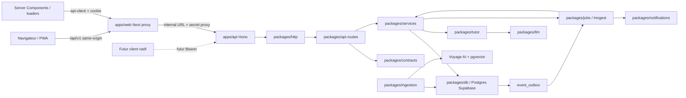
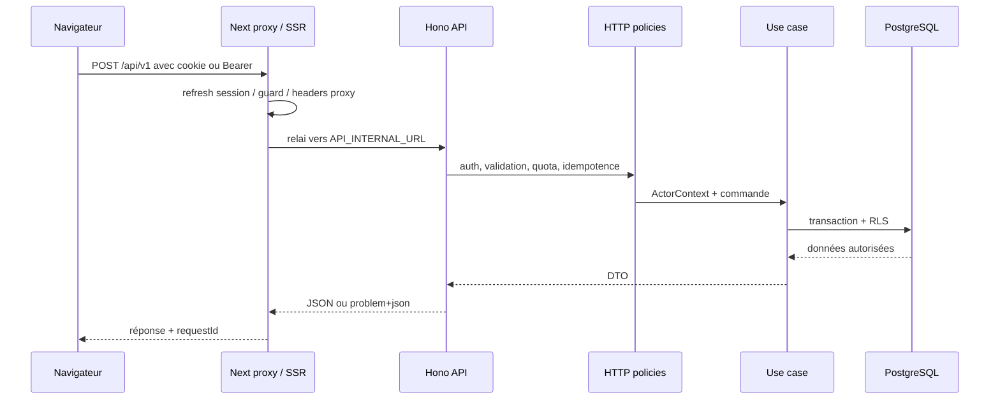
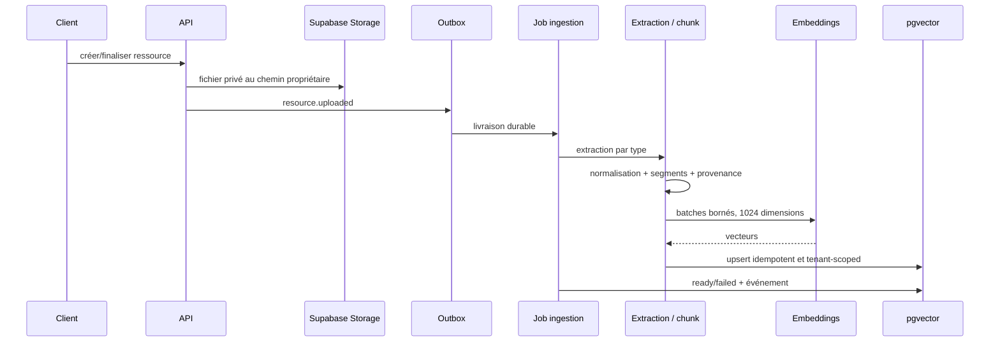

# 03 — Cartographie des dépendances et couplages

## Architecture observée



État code observé. La frontière d’application existe; le dépôt ne prouve pas encore les clients natifs ni l’indépendance de release du web.

## Couplages et recommandations

| Couplage | Emplacement/fait | Criticité | Risque | Découplage |
|---|---|---:|---|---|
| Navigateur → chemin/API et cookies | packages/api-client/src/client.ts: chemin /api/v1, same-origin | Moyenne | Le client doit connaître le transport web | OpenAPI public, URL/auth configurables, contrat stable |
| Next → backend | apps/web/proxy.ts; apps/web/lib/api/relay.ts | Élevée | API indisponible bloque relay; secret/forwarded headers confiance | Garder relay SSR temporaire, déplacer autorisation côté API |
| SSR → runtime Next | apps/web/lib/api/server-client.ts importe next/headers | Moyenne | loaders spécifiques Next; saut réseau | interface data côté web + client HTTP injectable |
| Proxy → logique produit/auth | apps/web/proxy.ts: session refresh, onboarding, garde formation | Élevée | source d’autorisation partagée entre frontend et backend | API devient source d’autorité; redirections restent UX |
| API → types/contracts TS | packages/http et api-routes dépendent contracts Zod | Élevée pour Python | contrat TypeScript ne s’importe pas en Python; OpenAPI omet certains events/SSE | OpenAPI versionné, génération TS, tests de compatibilité, contrat SSE documenté |
| Services → paquets transverses | packages/services/src, DB/LLM/jobs/domain | Élevée | graphe réel croisé, migration par paquet fragile | bounded contexts, ports, dépendances unidirectionnelles |
| Auth → Supabase | packages/http/src/session.ts et db client | Élevée | RLS suppose claims/rôles, cookie refresh côté client | identity adapter + claims dans transaction |
| DB → Supabase/Drizzle/postgres.js | packages/db/src/client.ts, migrations | Très élevée | RLS auth.uid(), fonctions, triggers, Storage non portés par ORM | garder SQL/RLS initialement; user UoW explicite |
| Jobs → Inngest TypeScript | packages/jobs/src/define.ts, emit.ts | Élevée | parité Python non totale, événement at-least-once | event schema versionné; conformité SDK; séparer consumers |
| Tutor → Vercel AI SDK | packages/llm/src, packages/tutor/src | Élevée | types/streaming/outils TS spécifiques | ports LLM indépendants, protocoles structurés |
| Ingestion → Voyage/extracteurs | packages/ingestion/src | Élevée | dimension, extraction et re-embeddings | version modèle/chunk; adapters; plan double index |
| API/Web release → secrets et versions | .github/workflows/deploy.yml, docker, .env.example | Élevée | drift API/web, rotation proxy, compatibilité contrat | release manifest N/N-1, rollback, health versionné |

## Flux d’une requête



La route formation peut être contrôlée dans le proxy puis réévaluée dans le service/RLS. Le premier contrôle décide un vrai 404 avant SSR streaming; le second reste la protection métier.

## Flux IA et outbox

```mermaid
sequenceDiagram
  participant API
  participant S as Service applicatif
  participant DB
  participant O as event_outbox
  participant I as Inngest
  participant J as Job
  participant T as Tutor / LLM
  API->>S: demande de génération
  S->>DB: état + événement dans transaction
  DB->>O: événement durable
  S-->>API: acceptation / état
  O->>I: dispatch après commit; tick rejoue pending
  I->>J: job avec steps idempotents
  J->>S: invoke service directement
  S->>T: tâche structurée
  T-->>S: résultat validé
  S->>DB: résultat + événements
```

Les retries et événements dupliqués font partie du modèle. L’appel IA est une opération externe non transactionnelle.

## Flux ingestion



Le pipeline doit conserver suppression concurrente, reprise et accès Storage. Un type dans un enum n’est pas preuve d’extracteur.
