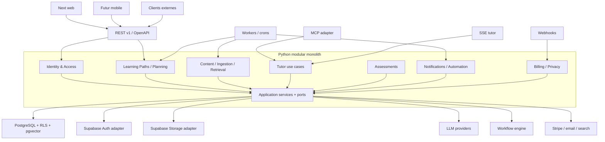

# 04 — Architecture cible Python headless

## Principes

- Monolithe modulaire, modèle métier et schéma DB partagés au début.
- Domain ne connaît ni framework HTTP, ORM, Supabase SDK, queue ou fournisseur IA.
- Application contient use cases, autorisations, règles de retry, orchestration et transactions.
- Infrastructure implémente ports pour Postgres, Auth, Storage, embeddings, LLM, événements, notifications et paiements.
- REST, SSE, webhooks, workers, crons et MCP adaptent leurs entrées vers les mêmes use cases.
- Les workers appellent l’application directement, jamais l’API par HTTP interne.
- Contrat public indépendant des tables et des besoins de Next.

## Diagramme cible

## Contextes et dépendances autorisées

- Identity & Access : ActorContext, profils, credentials et memberships; pas de dépendance au SDK Supabase dans l’apprentissage.
- Formation & Programme : formations, programmes, modules/chapitres/notions; event programme.validated.
- Learning State & Planning : mastery, FSRS, gaps, slots, streaks; calcul pur, données propriétaires.
- Content & Retrieval : ressources, chunks, provenance, index vectoriel et ingestion.
- Tutor & Conversations : contexte autorisé, tools en allowlist, sorties structurées; ne peut modifier arbitrairement la base.
- Assessments : activités, tentatives, résultats; demande les mises à jour de progression par l’application.
- Engagement : notifications/automatismes; consomme événements et ne mute pas les tables d’un autre domaine directement.
- Billing & Entitlements : droit d’accès au produit; coût IA BYOK séparé.
- Privacy & Accounts : orchestre export, rétention et suppression avec commandes explicites de chaque propriétaire.

Cross-contexts passent par commands/queries applicatives ou événements versionnés. Les modules ne partagent pas leurs modèles ORM internes. Aucun module artificiel par écran.

## Organisation suggérée

- apps/api : factory ASGI, REST, health/readiness.
- apps/worker : consumer et scheduler.
- packages/learny-domain : types et policies pures.
- packages/learny-application : commands, queries, UoW, ports.
- packages/learny-infrastructure : SQLAlchemy/Postgres, Supabase, LLM et queue.
- interfaces REST/SSE/webhook/MCP, éventuellement rangées par contexte.
- api/openapi.yaml : contrat versionné source du SDK TypeScript.
- apps/web reste sous pnpm; Python sous uv.
- Turbo orchestre les commandes globales; il ne gère pas le venv Python.
- Pas de microservices sans mesure d’isolation, scaling ou indépendance de livraison.

## Exécution commune

HTTP : auth → validation contrat → use case avec ActorContext → transaction/UoW → règles métier → état + outbox → commit → DTO.

Job : event schema/version → même use case → UoW et idempotency key → nouvel état/notifications. Livraison at-least-once; effets externes idempotents ou compensables.

## Déploiement

API et workers sont des containers distincts, issus de la même version Python, scalables séparément. Migration DB est un job de release singleton. Web peut garder un proxy SSR temporaire; le proxy n’est pas l’autorité d’accès. Readiness sonde DB/queue avec timeout; liveness ne fait pas de requêtes coûteuses.
